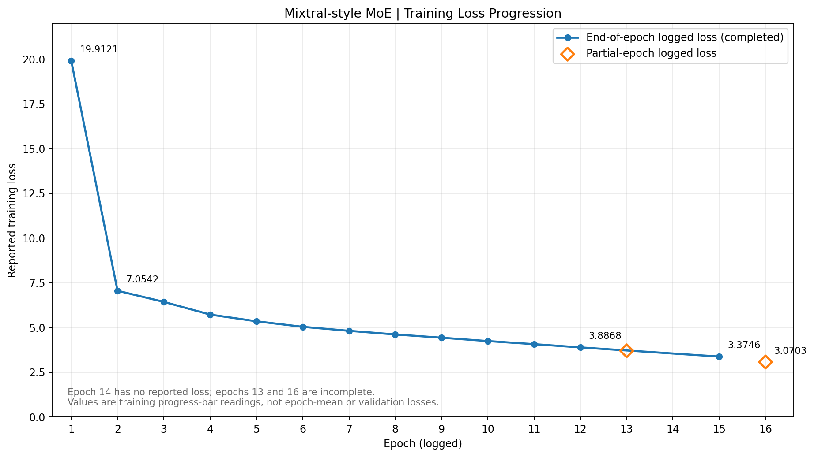

# Mixtral-Style Mixture-of-Experts Transformer — From Scratch in PyTorch

**Research-oriented implementation and training experiment** with sparse Mixture-of-Experts (MoE) routing, Grouped-Query Attention (GQA), Rotary Positional Embeddings (RoPE), sliding-window causal attention, RMSNorm, and SwiGLU experts. The model is trained from randomly initialized weights on **FineWeb-Edu** using an **NVIDIA A100 SXM (80 GB)**.

> **Scope:** This is an educational/research-scale **Mixtral-inspired** model, **not** the official Mixtral 8×7B checkpoint or an official reproduction of its parameter count or performance. It is a pretraining experiment, not an instruction-tuned assistant.

## Highlights

- Decoder-only causal language model with **8 experts per MoE block** and **top-2 routing**.
- GQA + RoPE, sliding-window masking, residual connections, and RMSNorm.
- BF16 mixed precision, fused AdamW when available, cosine learning-rate decay and gradient clipping.
- On-disk token cache, shuffled multiworker batches, gradient accumulation, and periodic resumable checkpoints.
- Logged training loss decreases from **19.9121 (epoch 1)** to **3.3746 (epoch 15)**; a subsequent **partial epoch 16** reading is **3.0703**. These are the reported *progress-bar losses*, not independently computed epoch means.
- **Run interrupted by full disk (100% utilization):** the latest available model state was recovered despite the training interruption.

## Architecture

| Component | Saved notebook default |
|---|---|
| Hidden dimension | 512 |
| Decoder layers | 8 |
| Query attention heads | 8 |
| Key/value heads | 4 |
| MoE experts | 8 |
| Active experts per token | 2 |
| Expert hidden dimension | 1,376 |
| Training context length | 512 tokens |
| Sliding attention window | 256 tokens |
| Tokenizer | `HuggingFaceTB/SmolLM2-135M` |

**Experiment configuration note:** This table reflects the values present in the uploaded notebook. The recorded training run may have used changed in-session values (for example, `D_MODEL=768`, `N_LAYERS=12`, `N_HEADS=12`, `N_KV_HEADS=4`) which are **not independently confirmed** by the log. For exact reproducibility, refer to the `config` dictionary in the training checkpoint that produced the results.

### Forward computation

`Token embeddings → [RMSNorm → GQA + RoPE + sliding-window causal attention → residual → RMSNorm → top-2 routed SwiGLU MoE → residual] × N_LAYERS → RMSNorm → vocabulary projection`

The MoE router selects two of eight experts for each token. The notebook additionally computes an auxiliary routing term, weighted by `AUX_LOSS_COEF=0.01`, alongside next-token cross-entropy. Expert dispatch uses Python loops and dynamic indexing, so this is not a fused production MoE implementation.

## Data and training methodology

- **Corpus:** `HuggingFaceFW/fineweb-edu`, configuration `sample-10BT`, streamed from the training split.
- **Preprocessing:** tokenize up to `MAX_DOCUMENTS=30000` documents, concatenate tokenized text with EOS separators, and pack overlapping next-token training records of 513 IDs (512 input tokens and 512 shifted targets).
- **Local caching:** write token IDs into a memory-mapped binary file to avoid repeated remote streaming/tokenization during subsequent epochs.
- **Optimizer:** AdamW (`lr=3e-4`, `weight_decay=0.1`, betas 0.9/0.95).
- **Scheduling:** 200 warmup steps followed by cosine decay; **max training time:** 390 minutes in the uploaded notebook (the observed run may differ).
- **Batching:** 32 sequences per microbatch, 4 accumulation steps = **128 sequences / 65,536 token positions per optimizer update**, before any last partial accumulation.
- **Runtime:** NVIDIA A100 SXM 80 GB GPU; BF16 autocast; 4 DataLoader workers; checkpoint saves about every 600 seconds.

The reported logs show about **1,989 microbatches per complete epoch**, approximately **8 min 18–23 s per epoch**, and **498 optimizer updates per epoch**. Those timings exclude any initial cache creation and may vary with GPU, storage and runtime state.

## Training results



The graph reproduces the available logged **training loss** readings. Epoch 14 is omitted because the supplied log contains no loss. Epochs 13 and 16 are shown as **partial** observations, not completed epochs. No independent validation loss, benchmark, or held-out perplexity was supplied.

| Epoch | Logged loss | Status |
|---:|---:|---|
| 1 | 19.9121 | Complete |
| 2 | 7.0542 | Complete |
| 3 | 6.4302 | Complete |
| 4 | 5.7213 | Complete |
| 5 | 5.3474 | Complete |
| 6 | 5.0378 | Complete |
| 7 | 4.8137 | Complete |
| 8 | 4.6103 | Complete |
| 9 | 4.4290 | Complete |
| 10 | 4.2407 | Complete |
| 11 | 4.0680 | Complete |
| 12 | 3.8868 | Complete |
| 13 | 3.6987 | **Partial (90%)** |
| 14 | — | Loss unavailable |
| 15 | 3.3746 | Complete |
| 16 | 3.0703 | **Partial (53%)** |

The final partial reading is about **84.6% below the epoch-1 reported reading**. These values show improvement on the training objective, **not** verified generalization or factual correctness. The first very high reading may reflect different training dynamics than later readings.

## Training interruption, recovery, and compute cost

**Training did not finish as planned.** During the paid NVIDIA A100 experiment, the runtime disk reached **100% utilization**, leaving no free storage for additional checkpoints or other outputs. Training consequently stopped because of **storage exhaustion**, not because the model had converged or met a defined evaluation target.

Despite the interruption, I managed to **recover the latest available updated model state**. This preserved the progress achieved up to the interruption, although it does not imply that the intended training schedule was completed or that all optimizer/scheduler state was recoverable.

| Resource / outcome | Reported detail |
|---|---|
| Accelerator | Paid NVIDIA A100 SXM, 80 GB VRAM |
| GPU training time | Approximately **4–5 hours** (user-reported estimate) |
| Compute cost | Approximately **US$10** consumed |
| Interruption | Runtime disk reached **100% capacity** |
| Checkpoint recovery | Latest available updated model state recovered |
| Final status | **Interrupted — not a completed training run** |

**Cost and runtime note:** The time and expense above are approximate user-reported figures, not independently verified billing metrics. The epoch durations in the logs cover individual training epochs and do not by themselves establish total wall-clock compute usage.

**Practical lesson:** GPU VRAM availability does not guarantee enough **persistent disk space**. Token caches, dataset artifacts, checkpoint snapshots, and optimizer state can occupy substantial storage. Future runs should monitor disk usage (`df -h` on Linux), enforce a checkpoint-retention policy, and periodically copy recoverable checkpoints to separate persistent storage before the volume becomes full.

## Generated samples: qualitative observations

**Fixed prompt:** `The Economics of Ecosystems and Biodiversity:`

**Epoch 1 — repetition:**

```text
The Economics of Ecosystems and Biodiversity:
- the
- the
- the and and and and is the is the and is the...
```

**Epoch 8 — partially structured phrases:**

```text
The Economics of Ecosystems and Biodiversity: The Times of the Conversation is a series of articles and articles, and is a series of articles, articles, articles, and articles.
- The History of the World.
- The World of
```

**Epoch 12 — more bibliographic-like formatting, not necessarily factual:**

```text
The Economics of Ecosystems and Biodiversity: An Introduction to the Study of Evolution. New York: Columbia University Press.
- Kutland, J. 1993. “The Economic and Social Policy of the 19
```

Outputs exhibit increasing local structure but still show repetition, truncation, and potentially fabricated references. **Generated titles, citations and dates should not be treated as factual.** The notebook's end-of-epoch quick test uses greedy decoding; the later generation demonstration offers top-k/temperature sampling.

## Installation

**Requirements:** Python 3.10+; a CUDA-enabled NVIDIA GPU with BF16 support (A100 recommended for the supplied configuration); enough free SSD space for a token cache and checkpoints; internet access for initial tokenizer/dataset downloads.

```bash
# 1. Clone your GitHub repository (replace with its real URL)
git clone <YOUR_GITHUB_REPOSITORY_URL>
cd <REPOSITORY_DIRECTORY>

# 2. Create and activate a virtual environment
python -m venv .venv
# Linux/macOS:
source .venv/bin/activate
# Windows PowerShell:
# .\.venv\Scripts\Activate.ps1

# 3. Install a CUDA-compatible PyTorch build using https://pytorch.org/get-started/locally/
# Then install notebook dependencies:
pip install numpy datasets transformers tqdm matplotlib jupyter ipykernel
```

Check GPU availability in Python:

```python
import torch
print(torch.cuda.is_available())
print(torch.cuda.get_device_name(0) if torch.cuda.is_available() else 'No CUDA GPU')
print(torch.cuda.is_bf16_supported() if torch.cuda.is_available() else False)
```

**Note:** The uploaded notebook explicitly requires CUDA and BF16, and uses a hard-coded output directory under `/workspace/` (typical of RunPod). Change `OUTPUT_DIR` to a writable local path if running elsewhere; adjust dataset document count and batch size for available compute, VRAM, RAM, and disk space.

## How to run the experiment

1. Open `Untitled_A100_optimized_documented.ipynb` in Jupyter or VS Code.
2. Run the **imports**, **CUDA check**, and **configuration** cells; verify the dataset/tokenizer IDs and `OUTPUT_DIR`.
3. Run the **model definition** and **forward sanity-check** cells.
4. Run **token cache preparation**. First execution downloads/streams the source dataset; subsequent executions reuse the existing cache if valid.
5. Create the **DataLoader**, optimizer and learning-rate scheduler. Execute the training smoke test carefully: it performs a real optimizer update (not just an assertion).
6. Run the `train_model(...)` cell. Review GPU memory, loss logs, checkpoints and sampled text. Set `MAX_TRAIN_MINUTES` for your compute budget.
7. Run the provided **loss plotting**, **generation** and **final model saving** cells after training; checkpoints can be restored with `load_training_checkpoint(...)`.

### Save / resume / generate

- Periodic checkpoints include **model weights, optimizer state, scheduler state, step counter and loss history** under `OUTPUT_DIR/checkpoints`.
- The final export stores `final_model/model.pt` plus tokenizer files when the final-save cell runs.
- To reproduce an experiment precisely, match the original saved checkpoint's architecture settings before loading state dictionaries.
- This is a **custom `nn.Module`**, not a Hugging Face `AutoModelForCausalLM`; its custom inference functions must be used unless a compatible adapter is implemented.

## Limitations and reproducibility

1. **No validation split or held-out evaluation** is implemented in the notebook's shown training loop, so training loss and generation examples do not establish generalization.
2. **No guarantee of factuality or coherence**: observed samples contain repetition and invented-looking citations.
3. **MoE routing overhead**: Python expert loops and dynamic masking may limit throughput compared with fused kernels.
4. **Autoregressive generation recomputes context** on every token because an inference KV cache is not implemented here.
5. **Metrics provenance**: progress-bar loss values are logged at specific training points, not necessarily uniform epoch-wide averages; the loss-history keys `lm_loss` and `total_loss` currently store the same combined loss, so they should not be reported as two independently tracked objectives.
6. **Weights availability**: checkpoint paths shown in training logs are local runtime paths, not public download links. No verified publicly downloadable weights URL was supplied for this Mixtral project.

## Research context

The experiment combines ideas from **Mixtral of Experts**, **Mistral 7B** (sliding-window attention), **Grouped-Query Attention**, **RoFormer/RoPE**, and **SwiGLU**. It is an independent learning/research implementation and should not be confused with official released weights or benchmarks.

Suggested references:

- Jiang et al., *Mixtral of Experts* (2024) — https://arxiv.org/abs/2401.04088
- Jiang et al., *Mistral 7B* (2023) — https://arxiv.org/abs/2310.06825
- Ainslie et al., *GQA: Training Generalized Multi-Query Transformer Models from Multi-Head Checkpoints* (2023) — https://arxiv.org/abs/2305.13245
- Su et al., *RoFormer: Enhanced Transformer with Rotary Position Embedding* (2021) — https://arxiv.org/abs/2104.09864
- Shazeer, *GLU Variants Improve Transformer* (2020) — https://arxiv.org/abs/2002.05202

---

**Project status:** Experimental from-scratch training study, **interrupted by full disk capacity**, with the latest available model state recovered. The attached notebook and reported metrics document the observed run; additional held-out evaluation and independent benchmarking are future work.
